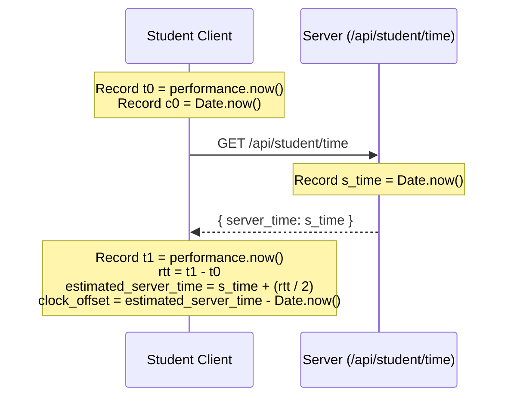
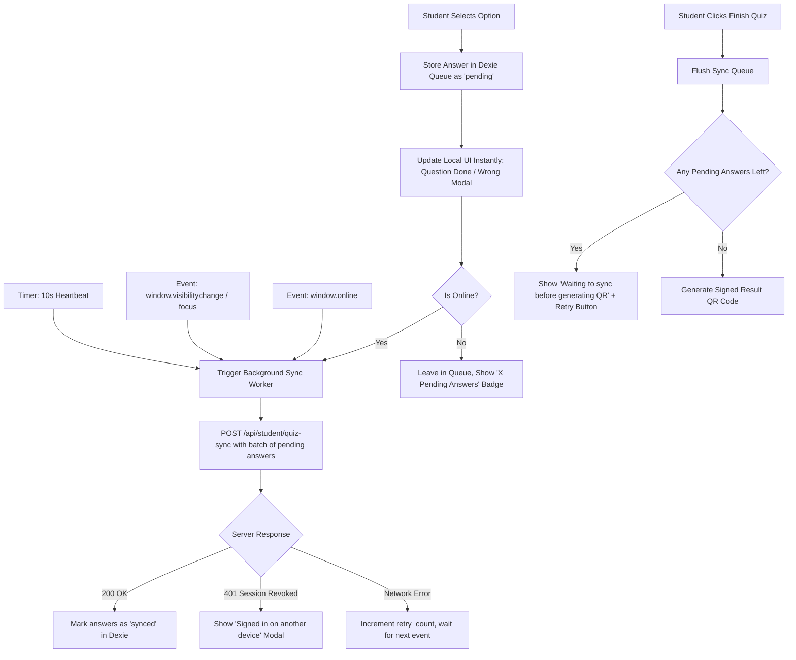

# QuizGate: Technical Architecture and Implementation Plan

## 1. System Overview
QuizGate is a QR-secured, offline-resilient quiz Progressive Web App (PWA) designed for classroom environments. It solves student impersonation, countdown manipulation, offline connectivity loss, and cross-device session continuation.

---

## 2. Data Model (PostgreSQL / Supabase)

### Tables & Schemas

```sql
-- 1. Classes
CREATE TABLE classes (
  id UUID PRIMARY KEY DEFAULT gen_random_uuid(),
  teacher_id UUID NOT NULL REFERENCES auth.users(id) ON DELETE CASCADE,
  name TEXT NOT NULL,
  created_at TIMESTAMPTZ NOT NULL DEFAULT now()
);

-- 2. Students
CREATE TABLE students (
  id UUID PRIMARY KEY DEFAULT gen_random_uuid(),
  class_id UUID NOT NULL REFERENCES classes(id) ON DELETE CASCADE,
  name TEXT NOT NULL,
  student_number TEXT NOT NULL,
  qr_secret_hash TEXT NOT NULL UNIQUE, -- SHA-256(student_secret_token)
  created_at TIMESTAMPTZ NOT NULL DEFAULT now(),
  CONSTRAINT uq_class_student_number UNIQUE (class_id, student_number)
);

-- 3. Quizzes
CREATE TABLE quizzes (
  id UUID PRIMARY KEY DEFAULT gen_random_uuid(),
  teacher_id UUID NOT NULL REFERENCES auth.users(id) ON DELETE CASCADE,
  class_id UUID NOT NULL REFERENCES classes(id) ON DELETE CASCADE,
  title TEXT NOT NULL,
  description TEXT,
  time_limit_mins INTEGER NOT NULL DEFAULT 15,
  status TEXT NOT NULL DEFAULT 'draft' CHECK (status IN ('draft', 'ready', 'active', 'ended')),
  started_at TIMESTAMPTZ,
  ends_at TIMESTAMPTZ,
  instant_feedback BOOLEAN NOT NULL DEFAULT true,
  allow_retry BOOLEAN NOT NULL DEFAULT false,
  hmac_secret TEXT NOT NULL DEFAULT encode(gen_random_bytes(32), 'hex'),
  created_at TIMESTAMPTZ NOT NULL DEFAULT now()
);

-- 4. Questions
CREATE TABLE questions (
  id UUID PRIMARY KEY DEFAULT gen_random_uuid(),
  quiz_id UUID NOT NULL REFERENCES quizzes(id) ON DELETE CASCADE,
  question_text TEXT NOT NULL,
  options JSONB NOT NULL, -- [{"id": "opt_1", "text": "Option A"}, ...]
  correct_option_id TEXT NOT NULL, -- Kept server-side only during active quiz
  salt TEXT NOT NULL DEFAULT encode(gen_random_bytes(16), 'hex'),
  correct_option_hash TEXT NOT NULL, -- SHA256(question_id || ':' || correct_option_id || ':' || salt)
  order_num INTEGER NOT NULL DEFAULT 0,
  created_at TIMESTAMPTZ NOT NULL DEFAULT now()
);

-- 5. Student Quiz Sessions (Enforces Single Active Device)
CREATE TABLE quiz_sessions (
  id UUID PRIMARY KEY DEFAULT gen_random_uuid(),
  quiz_id UUID NOT NULL REFERENCES quizzes(id) ON DELETE CASCADE,
  student_id UUID NOT NULL REFERENCES students(id) ON DELETE CASCADE,
  session_token_hash TEXT NOT NULL UNIQUE,
  device_info TEXT,
  is_active BOOLEAN NOT NULL DEFAULT true,
  started_at TIMESTAMPTZ NOT NULL DEFAULT now(),
  last_seen_at TIMESTAMPTZ NOT NULL DEFAULT now()
);
CREATE UNIQUE INDEX idx_single_active_session ON quiz_sessions (quiz_id, student_id) WHERE is_active = true;

-- 6. Quiz Attempts
CREATE TABLE quiz_attempts (
  id UUID PRIMARY KEY DEFAULT gen_random_uuid(),
  quiz_id UUID NOT NULL REFERENCES quizzes(id) ON DELETE CASCADE,
  student_id UUID NOT NULL REFERENCES students(id) ON DELETE CASCADE,
  status TEXT NOT NULL DEFAULT 'in_progress' CHECK (status IN ('in_progress', 'completed', 'timed_out')),
  score INTEGER NOT NULL DEFAULT 0,
  total_questions INTEGER NOT NULL DEFAULT 0,
  submitted_at TIMESTAMPTZ,
  result_hmac TEXT,
  created_at TIMESTAMPTZ NOT NULL DEFAULT now(),
  CONSTRAINT uq_quiz_student_attempt UNIQUE (quiz_id, student_id)
);

-- 7. Quiz Answers
CREATE TABLE quiz_answers (
  id UUID PRIMARY KEY DEFAULT gen_random_uuid(),
  attempt_id UUID NOT NULL REFERENCES quiz_attempts(id) ON DELETE CASCADE,
  question_id UUID NOT NULL REFERENCES questions(id) ON DELETE CASCADE,
  selected_option_id TEXT NOT NULL,
  is_correct BOOLEAN NOT NULL DEFAULT false,
  client_timestamp TIMESTAMPTZ NOT NULL,
  server_timestamp TIMESTAMPTZ NOT NULL DEFAULT now(),
  offset_corrected_timestamp TIMESTAMPTZ NOT NULL,
  is_late_sync BOOLEAN NOT NULL DEFAULT false,
  CONSTRAINT uq_attempt_question UNIQUE (attempt_id, question_id)
);
```

### Row Level Security (RLS) & Student Data Isolation
1. **Teacher RLS**:
   - `classes`: `teacher_id = auth.uid()`
   - `students`: `class_id IN (SELECT id FROM classes WHERE teacher_id = auth.uid())`
   - `quizzes`: `teacher_id = auth.uid()`
   - `questions`: `quiz_id IN (SELECT id FROM quizzes WHERE teacher_id = auth.uid())`
   - `quiz_attempts`, `quiz_sessions`, `quiz_answers`: `quiz_id IN (SELECT id FROM quizzes WHERE teacher_id = auth.uid())`
2. **Student Access**:
   - Public/Anon direct table access is completely revoked (`REVOKE ALL ON ALL TABLES FROM anon, authenticated`).
   - Students communicate exclusively via Next.js server route handlers (`/api/student/*`).
   - Route handlers validate the student's Bearer `session_token` against `quiz_sessions`, verifying student identity and revoking invalidated sessions.

---

## 3. Cryptography & Security Specifications

### Student Identity QR
- **Generated Payload**: `quizgate:student:<32_byte_base64url_secret>`
- **Storage**: Database stores `SHA-256(student_secret_token)`. Plain secrets are never stored in the database.
- **Printed QR Sheet**: Teacher exports/prints QR sheets containing student name, student number, and the unique QR code.

### Result QR Verification
- **Payload Format**: `quizgate:result:<base64_json>.<hmac_signature_hex>`
- **Payload Data**:
  ```json
  {
    "attempt_id": "uuid",
    "student_id": "uuid",
    "student_number": "1001",
    "student_name": "Maria Santos",
    "quiz_id": "uuid",
    "score": 4,
    "total": 5,
    "submitted_at": "2026-11-23T08:30:00.000Z"
  }
  ```
- **HMAC Generation**: `HMAC-SHA256(canonical_json(payload), quiz.hmac_secret)`
- **Verification**: Teacher scans via `/teacher/verify` camera scanner. API route validates HMAC using server's `quiz.hmac_secret` AND queries `quiz_attempts` to verify record authenticity and score match.

### Offline Wrong-Answer Evaluation (Salted Hashes)
- Client receives questions with:
  ```json
  {
    "id": "q1",
    "question_text": "Solve 2x + 6 = 14",
    "options": [
      {"id": "opt_a", "text": "x = 3"},
      {"id": "opt_b", "text": "x = 4"},
      {"id": "opt_c", "text": "x = 5"}
    ],
    "salt": "a4f89b...",
    "correct_option_hash": "e3b0c442..."
  }
  ```
- Formula: `correct_option_hash = SHA-256(question_id + ":" + correct_option_id + ":" + salt)`.
- Client evaluation: When student taps `opt_a`, client computes `SHA-256(question_id + ":opt_a:" + salt)`. If it matches `correct_option_hash`, it is correct; otherwise it triggers the wrong-answer modal immediately.
- **Honest Security Analysis**:
  Because multiple-choice questions have only 2 to 5 options, an adversary with browser developer tools could precompute hashes for all options in less than 1 millisecond.
  *Remediation*:
  1. The server never returns the plaintext `correct_option_id`.
  2. Final grading is authoritative on the server inside `/api/student/quiz-sync` and `/api/student/quiz-finish`.
  3. A teacher toggle `instant_feedback` (default on) can be disabled for high-stakes exams. When off, `correct_option_hash` and `salt` are omitted from the client response.

---

## 4. Server-Time Offset & Clock Sync Algorithm



### Offset Normalization & Protection
1. `clock_offset` is stored in IndexedDB and memory.
2. Every answered question timestamp is calculated as:
   `offset_corrected_timestamp = local_answer_time + clock_offset`.
3. If student changes their device clock backwards or forwards during the quiz:
   - `Date.now()` shifts, but next sync recalculates `clock_offset = s_time + (rtt/2) - Date.now()`, keeping `offset_corrected_timestamp` invariant.
   - Monotonic check: Student client enforces that no subsequent answer has an `offset_corrected_timestamp` earlier than the previous answer.
4. Quiz remaining duration displayed to the student:
   `remaining_ms = max(0, quiz.ends_at - (Date.now() + clock_offset))`.

---

## 5. Offline Queue & Dexie Synchronization Algorithm

### Dexie Tables (Client IndexedDB)
- `answers_queue`:
  - `id` (auto-increment primary key)
  - `quiz_id` (string)
  - `question_id` (string)
  - `selected_option_id` (string)
  - `client_timestamp` (ISO string)
  - `offset_corrected_timestamp` (ISO string)
  - `sync_status` (`'pending'` | `'syncing'` | `'synced'`)
  - `retry_count` (integer)
- `quiz_state`:
  - `quiz_id` (string primary key)
  - `student_id` (string)
  - `session_token` (string)
  - `questions` (array)
  - `clock_offset` (number)
  - `ends_at` (ISO string)
  - `status` (`'waiting'` | `'active'` | `'completed'`)

### Sync Flow & Triggers


### Late-Sync Enforcement Rule (Server)
When `/api/student/quiz-sync` or `/api/student/quiz-finish` receives answers:
1. Server checks `offset_corrected_timestamp`:
   - If `offset_corrected_timestamp <= quiz.ends_at`: Accept answer.
   - If current `server_now > quiz.ends_at` AND `offset_corrected_timestamp <= quiz.ends_at`:
     Accept answer, mark `is_late_sync = true`.
   - If `offset_corrected_timestamp > quiz.ends_at + 5000ms` (5s network margin):
     Reject answer or mark as timed out.
2. In the teacher live roster and results table, late-synced answers display a visible amber badge: `"Late Sync"`.

---

## 6. Cross-Device Resume & Single Active Session

1. **Student QR Scan on Device 2**:
   - Device 2 submits QR token to `/api/student/session`.
   - Server runs database transaction:
     ```sql
     UPDATE quiz_sessions SET is_active = false WHERE quiz_id = $1 AND student_id = $2;
     INSERT INTO quiz_sessions (quiz_id, student_id, session_token_hash, is_active) VALUES ($1, $2, $new_hash, true);
     ```
   - Server queries all existing `quiz_answers` for this student and returns:
     - `answers`: map of `{ question_id: selected_option_id }`
     - `quiz`: status, `started_at`, `ends_at`, questions
   - Device 2 populates IndexedDB with past answers and jumps to the first unanswered question.
2. **Device 1 Eviction**:
   - When Device 1 triggers sync, heartbeat, or finish:
   - Server validates `session_token`. Finds `is_active = false`.
   - Server responds with HTTP `401 Unauthorized` / `{ error: 'SESSION_REVOKED' }`.
   - Device 1 aborts timers, blocks UI, and shows:
     `"Signed in on another device. This session is no longer active."`

---

## 7. Rate Limiting Strategy
- Implementation: In-memory sliding-window rate limiter per IP address for Edge/Node server routes.
- Endpoints protected:
  - `/api/student/session`: Max 10 requests / minute per IP.
  - `/api/teacher/verify-result`: Max 30 requests / minute per IP.
  - `/api/student/quiz-sync`: Max 60 requests / minute per IP.

---

## 8. API Routes Specification

| Method | Path | Auth | Purpose |
|---|---|---|---|
| POST | `/api/teacher/classes` | Teacher Bearer/Cookie | Create class |
| GET | `/api/teacher/classes/[id]/roster` | Teacher Bearer/Cookie | Get students in class |
| POST | `/api/teacher/classes/[id]/students` | Teacher Bearer/Cookie | Add student (manual or CSV batch) |
| GET | `/api/teacher/classes/[id]/print-qr` | Teacher Bearer/Cookie | Fetch students with freshly minted QR payload tokens |
| POST | `/api/teacher/quizzes` | Teacher Bearer/Cookie | Create / update quiz & questions |
| POST | `/api/teacher/quizzes/[id]/start` | Teacher Bearer/Cookie | Start quiz (`status = 'active'`, `started_at = now()`, `ends_at = now() + interval`) |
| POST | `/api/teacher/quizzes/[id]/end` | Teacher Bearer/Cookie | Force end quiz (`status = 'ended'`, `ends_at = now()`) |
| GET | `/api/teacher/quizzes/[id]/live` | Teacher Bearer/Cookie | Live poll/stream roster status, sync status, and scores |
| GET | `/api/teacher/quizzes/[id]/export-csv` | Teacher Bearer/Cookie | Download graded results as CSV |
| POST | `/api/teacher/verify-result` | Teacher Bearer/Cookie | Verify student Result QR HMAC & database attempt |
| GET | `/api/student/time` | None | Returns `{ server_time: Date.now() }` for clock calibration |
| POST | `/api/student/session` | None (Rate Limited) | QR login with student secret token; returns session token & current quiz state |
| GET | `/api/student/quiz-state` | Student Session Token | Heartbeat, poll quiz status (`waiting` -> `active` -> `ended`) |
| POST | `/api/student/quiz-sync` | Student Session Token | Push batch of queued answers from IndexedDB |
| POST | `/api/student/quiz-finish` | Student Session Token | Finalize attempt, grade answers, generate signed result payload & HMAC |

---

## 9. Screen List & Mobile-First UX (360px Width Target)

### Teacher Authentication (Username & Password)
- **Login Credentials**: Clean username and password (no real email required or requested).
- **Implementation**: Teacher accounts authenticate with username + password. Internally, mapped cleanly to an auth identifier (e.g. `username@quizgate.local` in Supabase Auth or a hashed credentials table with HTTP-only signed session cookies), giving full RLS support with `auth.uid()` / teacher UUID without requiring real email delivery, verification links, or email formatting on the user-facing login form.

2. **Classes & Roster (`/teacher/classes`, `/teacher/classes/[id]`)**:
   - Class selector, create class.
   - Student list table with Student Number, Full Name, and QR generation status.
   - CSV File Upload dropzone (columns: `name, student_number`).
   - "Print Student QR Sheet" button.
3. **Print QR Sheet (`/teacher/classes/[id]/print-qr`)**:
   - Print stylesheet (`@media print`) arranging 6-8 students per A4 page.
   - Each card displays student full name, student number, and a high-contrast QR code (`size=160`).
4. **Quiz Builder (`/teacher/quizzes/new`, `/teacher/quizzes/[id]`)**:
   - Title, class assignment, time limit in minutes.
   - Question list with dynamic options (2 to 5 options), correct answer radio button.
   - Toggles: Instant Feedback (on/off), Allow Retry (on/off).
5. **Live Quiz Command Center (`/teacher/quizzes/[id]/live`)**:
   - Sticky header with Status pill, Start Quiz button, End Quiz button, and large synchronized countdown timer.
   - Live Roster cards / table:
     - Student Name, Student Number.
     - Status badge: `Not Started` (gray), `In Progress` (blue), `Done` (green), `Pending Sync` (amber), `Late Sync` (orange).
     - Live score and submitted timestamp.
   - Quick "Verify Result QR" modal button using device camera.
   - "Export Results CSV" button.
6. **Result QR Verification Scanner (`/teacher/verify`)**:
   - Fullscreen camera viewfinder with target overlay.
   - Instant validation card:
     - Valid: Green banner, Student Name, Student ID, Quiz Title, Score (e.g. 5/5), Submission Timestamp.
     - Invalid / Tampered: Red banner, warning reason.

### Student Views (PWA, Mobile First - 360px Min Target, 48px+ Tap Targets)
1. **Join / Scan QR (`/student`)**:
   - Install PWA prompt banner.
   - "Scan Student QR" button opening camera via `html5-qrcode` (or fallback token input / file upload for devices without camera permissions).
2. **Waiting Room Lobby (`/student/lobby`)**:
   - Greeting with student name and student number.
   - Assigned Quiz Title & Time Limit.
   - Animated pulse indicator: "Waiting for teacher to start quiz...".
   - Automatically launches quiz when teacher clicks Start.
3. **Active Quiz (`/student/quiz`)**:
   - Top Bar:
     - Fixed server-synced countdown timer (turns bold red under 60 seconds).
     - Progress indicator (e.g. "Question 3 of 5").
     - Connectivity pill: "Online" / "Offline (2 queued)".
   - Question Card:
     - Readable, high-contrast question text.
     - 2 to 5 large option cards (minimum 52px height) with active selection state.
     - Navigation controls ("Next", "Previous", "Submit Quiz").
   - Wrong Answer Modal:
     - If `instant_feedback` is active: full-width bottom sheet or modal appears instantly upon wrong choice.
     - Informs student: "Incorrect choice. Your answer is recorded."
     - Continue button (or retry button if `allow_retry` is enabled).
4. **Result Screen (`/student/result`)**:
   - Big score card: "You scored X out of Y".
   - If answers are still in Dexie sync queue:
     - Warning banner: "Waiting to sync before generating result QR... (X answers pending)".
     - Manual "Retry Sync Now" button.
   - Once all answers are synced:
     - High-resolution Result QR code containing the cryptographically signed HMAC payload.
     - Instruction: "Show this QR code to your teacher for verification."
5. **Session Evicted Overlay**:
   - Modal blocking interaction if user scans QR on another phone:
     "Signed in on another device. This session is now inactive."

---

## 10. Execution Plan & Phased Milestones

- **Phase A**: Database Schema, Supabase migrations, RLS policies, seed dataset (3 students, 1 class, 5-question math quiz).
- **Phase B**: Next.js App Router scaffolding, Supabase Auth for teachers, Class & Student CRUD, CSV importer, Printable QR sheet generation.
- **Phase C**: Quiz Builder, Teacher Live Dashboard (Start / End), Realtime status broadcast, Server Time calibration endpoint.
- **Phase D**: Student QR scanner & session auth, Student Lobby, Question-by-question layout, Salted feedback hashes and immediate wrong-answer popup.
- **Phase E**: Dexie IndexedDB offline queue, background sync on `online` and `focus`, Late-sync rule enforcement, cross-device session revocation.
- **Phase F**: Result QR generation with HMAC-SHA256, Teacher Result Camera Scanner with real-time verification against DB.
- **Phase G**: CSV Export, PWA manifest + Service Worker offline asset caching, Unit tests (timer offset, sync queue, late sync rules) and Playwright offline E2E test.
